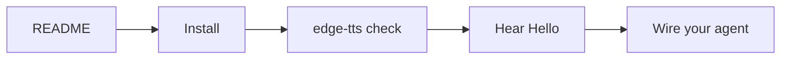

# First-run UX pass

## Goal
A newcomer hears "Hello from Echo" on the first try, and the README, tutorial, landing page and CLI help all point the same way.

## Now
All six units are already edited in the checkout and checked: site build passes, CLI tests pass (86), and `cli/echo --help` shows the new structure. The docs contracts need no change.

## Next
Commit the seven edited files plus this plan. Leave the unrelated dirty files alone.

## Risks
- The landing page still needs a visual check at phone width and desktop, in dark and light.
- The tutorial's edge-tts step assumes Homebrew Python at `/opt/homebrew/bin/python3`.
